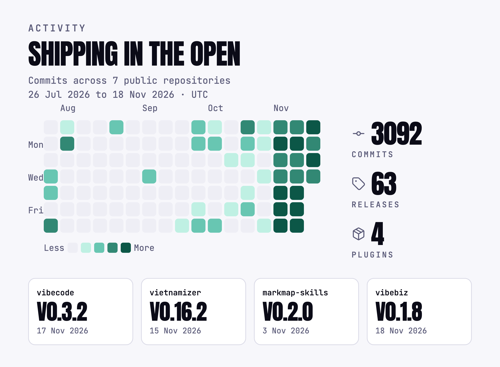

<picture>
  <source media="(prefers-color-scheme: dark)" srcset="assets/banner-dark.png">
  <source media="(prefers-color-scheme: light)" srcset="assets/banner-light.png">
  
</picture>

FINOLABS is an investment and technology company. Built on AI-native and tech-driven foundations, we sponsor business ventures from fashion and retail to lifestyle.

## Open source

Plugins for AI coding agents. Every coding-agent plugin lives in one shared catalog, [`finolabs/plugins`](https://github.com/finolabs/plugins), so Claude Code and Codex need a single marketplace source. The [developer hub](https://finolabs.io) lists them with install commands.

| Plugin | Description |
| --- | --- |
| [finolabs-vibecode](https://github.com/finolabs/vibecode) | 24 skills and 3 agents (reviewer, security-reviewer, navigator) for review routing, verification, setup, run hygiene and quota on demand. |
| [agybird](https://github.com/finolabs/agybird) | Delegate code work, image generation or editing, and general tasks to the official Google Antigravity CLI through an existing Gemini subscription. |
| [vietnamizer](https://github.com/finolabs/vietnamizer) | Viết và biên tập tiếng Việt tự nhiên hơn, giữ ý, dữ kiện, code và giọng người viết; hỏi “Vietnamizer làm được gì?” để xem tính năng và thiết lập giọng. |
| [markmap-skills](https://github.com/finolabs/markmap-skills) | Turn notes and documents into editable Markdown and interactive Markmap mindmaps, for Claude Code, Codex and Antigravity. No background daemon. |
| [vibebiz](https://github.com/finolabs/vibebiz) | A product owner for founders and business leaders: turns a vague idea for a system, an AI use or an automation into a clear, challenged, measurable PRD. |

vibebiz is source-available, not MIT: free for noncommercial use under PolyForm Noncommercial 1.0.0, with a [commercial license](https://github.com/finolabs/vibebiz/blob/main/COMMERCIAL-LICENSE.md) for business use. In Claude Cowork, install it from its [latest release](https://github.com/finolabs/vibebiz/releases/latest) through Settings › Plugins › Upload plugin.

<picture>
  <source media="(prefers-color-scheme: dark)" srcset="assets/activity-dark.png">
  <source media="(prefers-color-scheme: light)" srcset="assets/activity-light.png">
  
</picture>

Figures come from the GitHub API and the catalog. [How the images are generated](https://github.com/finolabs/.github/blob/main/scripts/profile-art/README.md).

## Install

Claude Code:

```bash
claude plugin marketplace add finolabs/plugins
claude plugin install finolabs-vibecode@finolabs
```

Codex:

```bash
codex plugin marketplace add finolabs/plugins
codex plugin add finolabs-vibecode@finolabs
```

Antigravity does not use a catalog. Install each plugin from its repository URL, for example `agy plugin install https://github.com/finolabs/vibecode`. Any other plugin installs the same way: change the plugin name in the Claude Code and Codex commands, and the repository URL in the Antigravity command. Details are in the [catalog README](https://github.com/finolabs/plugins#readme).

## Contact

- Email: [finos@finolabs.io](mailto:finos@finolabs.io)
- Security issues: see [SECURITY.md](https://github.com/finolabs/.github/blob/main/SECURITY.md)
- License: finolabs-vibecode, agybird, vietnamizer and markmap-skills are MIT licensed; vibebiz is source-available (see above).
