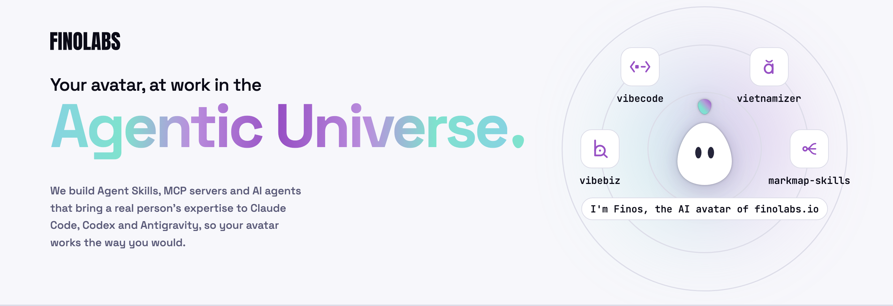

<picture>
  <source media="(prefers-color-scheme: dark)" srcset="assets/banner-dark.png">
  <source media="(prefers-color-scheme: light)" srcset="assets/banner-light.png">
  
</picture>

**Real expertise, agent-ready.**

FINOLABS builds Agent Skills and AI agents that bring a real person's expertise to Claude Code, Codex and Antigravity, so your avatar works the way you would. Everything below is MIT except vibebiz, which is source-available.

**[finolabs.io](https://finolabs.io)** · **[Plugin catalog](https://github.com/finolabs/plugins)** · **[Security policy](https://github.com/finolabs/.github/blob/main/SECURITY.md)**

## Plugins

Every plugin lives in its own repository and is listed in one shared catalog, [`finolabs/plugins`](https://github.com/finolabs/plugins), so Claude Code and Codex need a single marketplace source.

| Plugin | Description |
| --- | --- |
| [vibecode](https://github.com/finolabs/vibecode) | 24 skills and 3 agents (reviewer, security-reviewer, navigator) for review routing, verification, setup, run hygiene and quota on demand. |
| [vietnamizer](https://github.com/finolabs/vietnamizer) | Viết và biên tập tiếng Việt tự nhiên hơn, giữ ý, dữ kiện, code và giọng người viết; hỏi “Vietnamizer làm được gì?” để xem tính năng và thiết lập giọng. |
| [markmap-skills](https://github.com/finolabs/markmap-skills) | Turn notes and documents into editable Markdown and interactive Markmap mindmaps, for Claude Code, Codex and Antigravity. No background daemon. |
| [vibebiz](https://github.com/finolabs/vibebiz) | A product owner for founders and business leaders: turns a vague idea for a system, an AI use or an automation into a clear, challenged, measurable PRD. |

vibecode, vietnamizer and markmap-skills are MIT licensed. vibebiz is source-available, not open source: free for noncommercial use under PolyForm Noncommercial 1.0.0, with a [commercial license](https://github.com/finolabs/vibebiz/blob/main/COMMERCIAL-LICENSE.md) for business use.

## Get started

Claude Code:

```bash
claude plugin marketplace add finolabs/plugins
claude plugin install finolabs-vibecode@finolabs
```

Codex:

```bash
codex plugin marketplace add finolabs/plugins
codex plugin add finolabs-vibecode@finolabs
```

Google Antigravity does not use a catalog. Install each plugin from its repository URL, for example `agy plugin install https://github.com/finolabs/vibecode`.

Claude Cowork: download vibebiz from its [latest release](https://github.com/finolabs/vibebiz/releases/latest), then upload it in Settings › Plugins › Upload plugin.

For another plugin, change the plugin name in the commands or the repository URL. Details are in the [catalog README](https://github.com/finolabs/plugins#readme).

## Activity

<picture>
  <source media="(prefers-color-scheme: dark)" srcset="assets/activity-dark.png">
  <source media="(prefers-color-scheme: light)" srcset="assets/activity-light.png">
  
</picture>

Figures come from the GitHub API and the catalog, regenerated weekly. [How the images are generated](https://github.com/finolabs/.github/blob/main/scripts/profile-art/README.md).

## Support

- Bugs and feature requests: open an issue in the plugin's own repository.
- Security issues: report privately as the [security policy](https://github.com/finolabs/.github/blob/main/SECURITY.md) describes, never in a public issue.
- Business and licensing, including vibebiz commercial use: [finos@finolabs.io](mailto:finos@finolabs.io).

## About

FINOLABS also works alongside ventures from fashion and retail to lifestyle.
