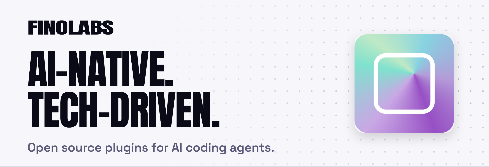
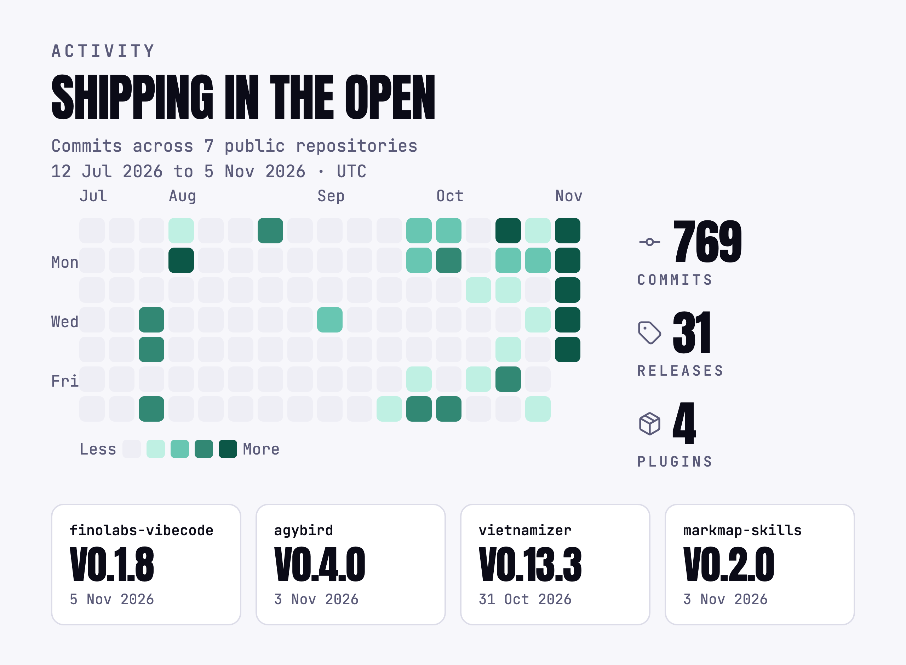

<picture>
  <source media="(prefers-color-scheme: dark)" srcset="assets/banner-dark.png">
  <source media="(prefers-color-scheme: light)" srcset="assets/banner-light.png">
  
</picture>

FINOLABS is an investment and technology company. Built on AI-native and tech-driven foundations, we sponsor business ventures from fashion and retail to lifestyle.

## Open source

Plugins for AI coding agents. Every coding-agent plugin lives in one shared catalog, [`finolabs/plugins`](https://github.com/finolabs/plugins), so Claude Code and Codex need a single marketplace source. The [developer hub](https://finolabs.io) lists them with install commands.

| Plugin | Description |
| --- | --- |
| [finolabs-vibecode](https://github.com/finolabs/finolabs-vibecode) | 17 skills and 3 agents (fnl-reviewer, fnl-security-reviewer, fnl-navigator) for review routing, verification, setup, run hygiene and quota on demand. |
| [agybird](https://github.com/finolabs/agybird) | Delegate code work, image generation or editing, and general tasks to the official Google Antigravity CLI through an existing Gemini subscription. |
| [vietnamizer](https://github.com/finolabs/vietnamizer) | Biên tập bản nháp, bài viết, README và bản dịch tiếng Việt cho tự nhiên hơn, giữ nguyên ý, dữ kiện, thuật ngữ, code và giọng người viết. |
| [markmap-skills](https://github.com/finolabs/markmap-skills) | Markmap mindmaps for AI agents with strict cognitive structuring, delivered as clean .mindmap.md files and standalone HTML pages. |

[vibebiz](https://github.com/finolabs/vibebiz) sits outside the catalog: a Claude Cowork plugin that works as a product owner for retail leaders, turning a vague idea into a board deck and a tech PRD with a Spec Kit-compatible requirement file. Install it from its [latest release](https://github.com/finolabs/vibebiz/releases/latest) through Cowork's Settings › Plugins › Upload plugin. It is source-available, not MIT: free for noncommercial use under PolyForm Noncommercial 1.0.0, with a [commercial license](https://github.com/finolabs/vibebiz/blob/main/COMMERCIAL-LICENSE.md) for business use.

<picture>
  <source media="(prefers-color-scheme: dark)" srcset="assets/activity-dark.png">
  <source media="(prefers-color-scheme: light)" srcset="assets/activity-light.png">
  
</picture>

Figures come from the GitHub API and the catalog. [How the images are generated](https://github.com/finolabs/.github/blob/main/scripts/profile-art/README.md).

## Install

Claude Code:

```bash
claude plugin marketplace add finolabs/plugins
claude plugin install finolabs-vibecode@finolabs
```

Codex:

```bash
codex plugin marketplace add finolabs/plugins
codex plugin add finolabs-vibecode@finolabs
```

Antigravity does not use a catalog. Install each plugin from its repository URL, for example `agy plugin install https://github.com/finolabs/finolabs-vibecode`. Any other plugin installs the same way: change the plugin name in the Claude Code and Codex commands, and the repository URL in the Antigravity command. Details are in the [catalog README](https://github.com/finolabs/plugins#readme).

## Contact

- Email: [finos@finolabs.io](mailto:finos@finolabs.io)
- Security issues: see [SECURITY.md](https://github.com/finolabs/.github/blob/main/SECURITY.md)
- License: the four catalog plugins are MIT licensed; vibebiz is source-available (see above).
